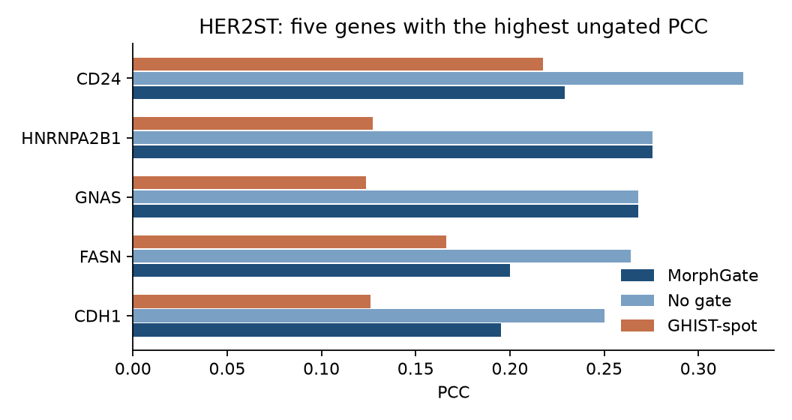
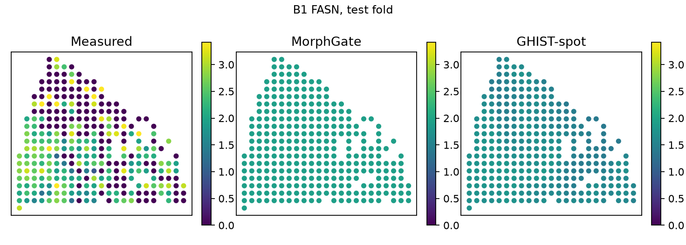
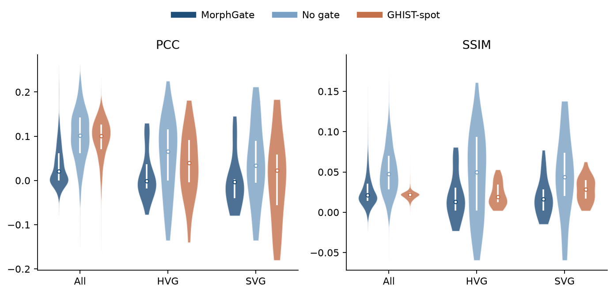
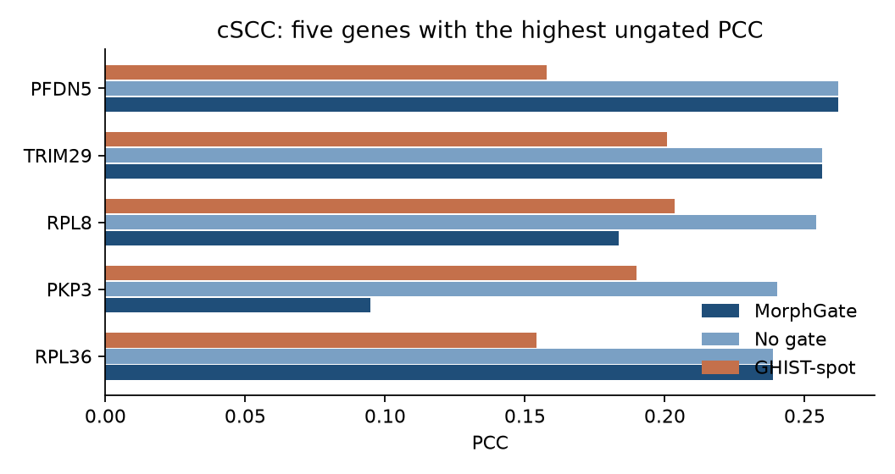

# 同一套基准下的 MorphGate 与 GHIST

对照协议来自 Wang 等人，*Benchmarking the translational potential of spatial gene expression prediction from histology*，Nature Communications，2025，[10.1038/s41467-025-56618-y](https://doi.org/10.1038/s41467-025-56618-y)。GHIST 原文是 Fu 等人，Nature Methods，2025，[10.1038/s41592-025-02795-z](https://doi.org/10.1038/s41592-025-02795-z)。

## 摘要

在 HER2 阳性乳腺癌（HER2ST，785 个基因）和皮肤鳞癌（cSCC，997 个基因）上，按这篇基准的四折、病人不拆开的划分，比较了 MorphGate 和斑点分辨率的 GHIST 组成模型。每个基因先在切片上计算，再对病人、再对四个测试折取平均。

带门控的 MorphGate 在 HER2ST 上的平均 Pearson 相关是 0.025，因为没通过门控的基因回填成训练集均值。去掉门控后是 0.071。同一划分上，六个表达程序的 GHIST-spot 是 0.044。GHIST 原文报告的是他们自己的深度网络，HER2ST 平均相关 0.16，空间可变基因 0.27。那一行是文献数字，没有放进这次的小提琴图。

cSCC 上，去掉门控的 MorphGate 是 0.099，GHIST-spot 是 0.093。两边的空间图都把 FASN 的动态范围压扁了。TCGA 生存和 Visium 跨研究没有重做。

## 协议

基准把 HER2ST 和 cSCC 各分成四折，同一病人的相邻切片留在同一折。每一轮用两折训练，一折做验证，一折做测试。原文用验证折挑选训练轮次。这里的岭回归没有训练轮次，验证折不参与拟合，也不用来挑选结果。下文的数字是四个测试折的平均，不是四个折里最好的那一折。

HER2ST 的四折是病人 AB、CD、EF、GH。cSCC 的四折是病人 P2、P5、P9、P10，各三张切片。基因是全体切片共有、log1p(CP10k) 方差最高的 785 个（HER2ST）和 997 个（cSCC）。高变基因取其中方差最高的 30 个。空间可变基因按阵列坐标上 6 个近邻的 Moran's I 排序，取平均名次最好的 20 个。原文的高变基因用 scran，空间可变基因用 SPARK-X，两份基因名单不会完全相同。

每个基因、每张切片计算四个量，再对同一病人的切片取平均，然后对折里的病人取平均，最后对四折取平均。

- Pearson 相关。预测是常数时记为 0。
- SSIM。先按该基因实测值的极差缩放到 0 到 1，再把整张切片的斑点当作一个窗口。C1 = 0.01²，C2 = 0.03²。
- 互信息。20 个箱，单位是 nat。
- AUC。实测值是否大于 0。
- NRMSE。均方根误差除以实测极差。

## 两个模型

MorphGate 用斑点及其六个近邻的苏木精/伊红特征做岭回归，惩罚系数 10。门控是训练集里字母最前的那位病人，相关低于 0.10 的基因回填训练集均值。图里的 “No gate” 是同一套特征、同一个惩罚，只是 785 或 997 个基因都回归。

GHIST 原文先分割细胞核，再用细胞类型、邻域、形态和表达四个任务一起训练。这次没有重跑那个网络，也没有使用他们的权重。GHIST-spot 只保留它对斑点数据的组成关系：在训练病人上用 k-means 得到 6 个表达程序，再用染色特征预测每个斑点的程序权重，预测表达是权重乘程序。图中的 GHIST-spot 是这个模型。

文献对照单独列出。Fu 等人在 HER2ST、785 个基因上报告的平均相关是 0.16，SSIM 是 0.10；高变基因相关 0.20、SSIM 0.17；空间可变基因相关 0.27、SSIM 0.26。他们的空间可变基因来自 SPARK-X，汇总方式还包含从四个测试折中选取表现最好的模型。

## 结果

*图 1. HER2ST，785 个基因。每个点是一个基因在四个测试折上的平均。白点是中位数，白线是四分位距。*

| HER2ST | PCC | 中位 PCC | SSIM | 互信息 | AUC | NRMSE | 高变 PCC | 空间可变 PCC |
| --- | ---: | ---: | ---: | ---: | ---: | ---: | ---: | ---: |
| MorphGate | 0.025 | 0.007 | 0.025 | 0.078 | 0.521 | 0.308 | 0.027 | 0.074 |
| 去掉门控 | 0.071 | 0.064 | 0.045 | 0.338 | 0.570 | 0.315 | 0.072 | 0.141 |
| GHIST-spot | 0.044 | 0.040 | 0.018 | 0.340 | 0.554 | 0.303 | 0.044 | 0.063 |
| GHIST 原文 | 0.16 |  | 0.10 |  |  |  | 0.20 | 0.27 |

四个折都通过门控的基因有 12 个。门控把大量基因收成常数，所以全基因平均相关落到 0.025。去掉门控之后，HER2ST 的相关、SSIM 和空间可变基因都高于 GHIST-spot。互信息几乎一样，0.338 和 0.340。NRMSE 三个模型都在 0.30 附近。

*图 2. HER2ST 的全部基因、30 个高变基因和 20 个空间可变基因。*

空间可变基因上，去掉门控的 MorphGate 平均相关 0.141，GHIST-spot 是 0.063。高变基因的差距较小，0.072 对 0.044。这 30 个高变基因里免疫球蛋白占了多数，例如 IGHG4、IGHA1、IGKC。空间可变基因里有 FN1、ERBB2、GNAS、CD24。

*图 3. HER2ST 上去掉门控后相关最高的五个基因，以及另外两个模型在这些基因上的相关。*

去掉门控后，CD24 是 0.324，HNRNPA2B1 是 0.276，GNAS 是 0.268，FASN 是 0.264，CDH1 是 0.250。GHIST 原文在他们的模型里报告 GNAS 0.42、FASN 0.42。这次 FASN 是 0.264，GNAS 是 0.268。

*图 4. 病人 B 的第一张切片，测试折上的 FASN。颜色范围按实测值的 2% 到 98% 分位。*

实测 FASN 在切片上从接近 0 到 3 以上。MorphGate 和 GHIST-spot 都挤在中间的一条窄带里，组织轮廓还在，高表达和低表达的区域没有分开。

*图 5. cSCC，997 个基因，四个测试折的平均。*

| cSCC | PCC | 中位 PCC | SSIM | 互信息 | AUC | NRMSE | 高变 PCC | 空间可变 PCC |
| --- | ---: | ---: | ---: | ---: | ---: | ---: | ---: | ---: |
| MorphGate | 0.036 | 0.021 | 0.028 | 0.096 | 0.538 | 0.270 | 0.014 | 0.000 |
| 去掉门控 | 0.099 | 0.102 | 0.051 | 0.232 | 0.605 | 0.273 | 0.051 | 0.038 |
| GHIST-spot | 0.093 | 0.101 | 0.022 | 0.243 | 0.615 | 0.260 | 0.036 | 0.006 |

cSCC 上两个全基因模型很接近。去掉门控的 MorphGate 相关略高，GHIST-spot 的 AUC 略高。空间可变基因两边都低，0.038 和 0.006。这 20 个基因主要是角化相关的 KRT1、KRT10、KRTDAP，以及原文也单独点过的 PFN1。四个折都通过门控的基因有 51 个，全基因平均因此只有 0.036。

*图 6. cSCC 的全部基因、30 个高变基因和 20 个空间可变基因。*

*图 7. cSCC 上去掉门控后相关最高的五个基因。*

HER2ST 四折的拟合时间是 MorphGate 0.39 秒，去掉门控 0.15 秒，GHIST-spot 9.57 秒。cSCC 分别是 0.55、0.13 和 13.32 秒。这是 CPU 上一次完整的四折拟合，不是原文按 GPU 上 10 个训练轮次计算的效率。

## 讨论

Wang 等人的全基因任务会奖励每一个基因都给出一个非常数预测。MorphGate 的门控故意不这样做。在这个协议下，门控把 HER2ST 的平均相关从 0.071 拉到 0.025，把空间可变基因从 0.141 拉到 0.074。门控保留下来的单个基因仍然可以到 0.2 以上，例如 GNAS 和 FASN，只是它们在 785 个基因里占的比例很小。

和同一次运行的 GHIST-spot 比，去掉门控的 MorphGate 在 HER2ST 上相关更高，空间结构也更接近实测。cSCC 上两者几乎并列。GHIST-spot 只有 6 个表达程序，预测只能落在这 6 个程序张成的空间里，动态范围会被压扁。图 4 里两个模型都是这样。

GHIST 原文的 0.16 和空间可变基因 0.27 高于这次的两个模型。那个数字来自他们的多任务网络、Hover-Net 细胞核标签和 SPARK-X 基因名单，并且原文会从四个测试折里取出表现最好的模型。把它和这次四折平均放在同一张小提琴图里会把两套实验说成一次实验，所以表里单独一行，图里没有这条线。

这篇基准还做了 Visium 跨研究、TCGA 图像质量和三种乳腺癌亚型的生存分析，一共 28 个指标。那些数据不在这次的输入里，没有补做。基准里当时领先的 EGNv2 报告过平均相关 0.28，那也是他们自己的汇总，不是这次划分上的重跑。

## 材料

HER2ST 来自 Andersson 等人，Zenodo [10.5281/zenodo.4751624](https://doi.org/10.5281/zenodo.4751624)。cSCC 来自 Ji 等人，GSE144240，Zenodo [13117873](https://zenodo.org/records/13117873)。服务器上的副本在 `/mnt/storage/bzhang/morphgate/data`。逐基因分数和这篇文章的表在 `results/comparison_summary.json`。

代码是 `python -m morphgate.compare`。GHIST 的仓库在 [SydneyBioX/GHIST](https://github.com/SydneyBioX/GHIST)，基准代码在 [SydneyBioX/HEtoSGEBench](https://github.com/SydneyBioX/HEtoSGEBench)。
