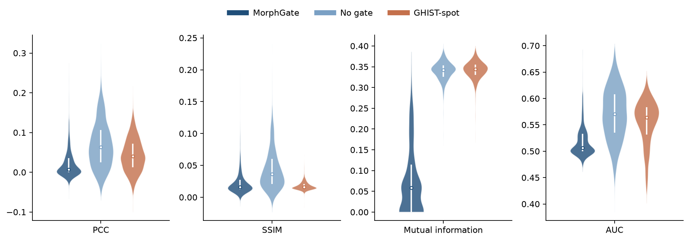
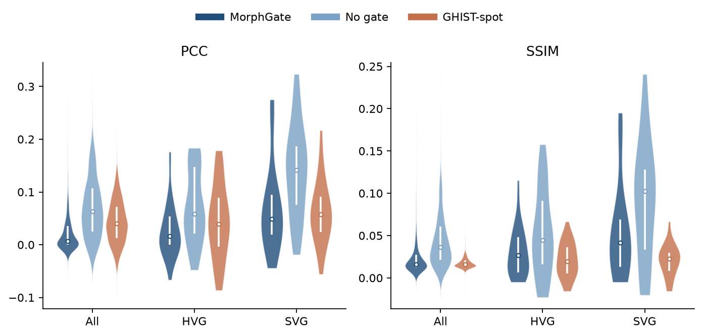
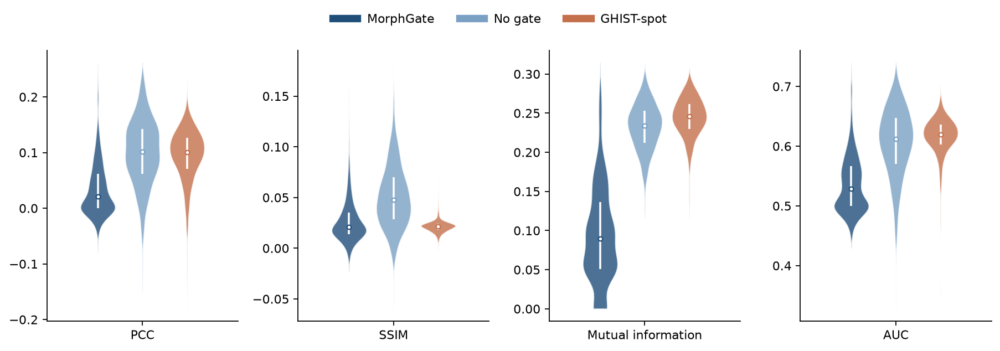

# 同一套基准下的 MorphGate 与 GHIST

对照协议采用 Wang 等，*Benchmarking the translational potential of spatial gene expression prediction from histology*，Nature Communications，2025，[10.1038/s41467-025-56618-y](https://doi.org/10.1038/s41467-025-56618-y)。GHIST 原文为 Fu 等，Nature Methods，2025，[10.1038/s41592-025-02795-z](https://doi.org/10.1038/s41592-025-02795-z)。

**术语约定。** 凡中文译名在文献中尚未统一、或译成中文后与其他概念混淆的术语，正文保留英文原词并在首次出现处给出中文说明：spot（Visium 阵列上的单个捕获点）、expression program（表达程序）、gating（门控）、highly variable genes（HVG，高变基因）、spatially variable genes（SVG，空间可变基因）、epoch（训练轮次）、bin（直方分箱）。Visium spot 不译作「斑点」，以免与图像处理中的 speckle 混淆。

## 摘要

在 HER2 阳性乳腺癌（HER2ST，785 个基因）与皮肤鳞状细胞癌（cSCC，997 个基因）上，按该基准的四折划分（同一病人的切片不跨折）比较 MorphGate 与 spot 分辨率的 GHIST 构成模型。每个指标先在单张切片上计算，再依次对同一病人的切片、折内病人取平均，最后对四个测试折取平均。

HER2ST 上，带门控的 MorphGate 平均 Pearson 相关为 0.025 —— 未通过门控的基因被填充为训练集均值，即常数预测。同一划分下去掉门控为 0.071；使用 6 个表达程序的 GHIST-spot 为 0.044。GHIST 原文报告的是其自身的深度网络：HER2ST 全基因平均相关 0.16，SVG 0.27。该行为文献值，未纳入本次的小提琴图。

cSCC 上去掉门控的 MorphGate 为 0.099，GHIST-spot 为 0.093。两个模型的空间图都压缩了 FASN 的动态范围。TCGA 生存分析与 Visium 跨研究未重做。

## 协议

基准将 HER2ST 与 cSCC 各划分为四折，同一病人的相邻切片留在同一折内。每轮以两折训练、一折验证、一折测试。原文用验证折选择 epoch；本文的岭回归没有 epoch，验证折不参与拟合，也不用于模型选择。下文的数字为四个测试折的平均，而非四折中的最优折。

HER2ST 的四折为病人 AB、CD、EF、GH；cSCC 的四折为 P2、P5、P9、P10，每折三张切片。基因取全体切片共有、按 log1p(CP10k) 方差排序最高的 785 个（HER2ST）与 997 个（cSCC）。HVG 为其中方差最高的 30 个。SVG 按阵列坐标上 6 个近邻的 Moran's I 排序，取平均名次最靠前的 20 个。原文的 HVG 用 scran、SVG 用 SPARK-X，两份基因列表不可能完全一致。

每个指标先在单张切片上计算，再对同一病人的切片取平均，然后对折内病人取平均，最后对四折取平均。

- **Pearson 相关（PCC）**：预测为常数时记为 0。
- **SSIM**：先按该基因实测值的值域线性缩放到 0–1，再把整张切片上的 spot 视为单一窗口。常数 C₁ = 0.01²，C₂ = 0.03²。**这是偏离标准定义的用法** —— 标准 SSIM 在局部窗口上滑动并取均值，单一窗口实际退化为全局统计量；此处沿用基准代码的实现，故标注。
- **互信息（MI）**：20 个 bin，以 nat 为单位。
- **AUC**：以「实测值是否大于 0」作为二分类标签。
- **NRMSE**：均方根误差除以实测值域。

## 两个模型

MorphGate 以 spot 及其 6 个近邻的苏木精/伊红特征作岭回归，L2 正则化系数 λ = 10。**门控的阈值由训练集中按字母序排在最前的一位病人（HER2ST 为 AB 折）单独确定**：相关低于 0.10 的基因被填充为训练集均值。该设计只在一位病人上做选择，不是在所有训练病人上共同估计——这一点影响门控的泛化性，如实记录。图中的 "No gate" 使用同一套特征与同一 λ，只是 785 或 997 个基因全部参与回归。

GHIST 原文先以 Hover-Net 分割细胞核，再用四类监督任务（细胞类型、邻域、形态、表达）联合训练。本次未重跑该网络，也未使用其权重。GHIST-spot 只保留其对 spot 数据的构成关系：在训练病人上以 k-means 得到 6 个表达程序，再用染色特征预测每个 spot 的程序权重，预测表达为各程序表达谱按权重线性加权之和。图中的 GHIST-spot 即此模型。

文献对照单独列出。Fu 等在 HER2ST、785 个基因上报告的平均相关为 0.16、SSIM 0.10；HVG 相关 0.20、SSIM 0.17；SVG 相关 0.27、SSIM 0.26。其 SVG 来自 SPARK-X，且**汇总口径包含从四个测试折中挑选表现最优的模型**——即在测试折上做过选择。

## 结果

*图 1. HER2ST，785 个基因。每个点为单个基因在四个测试折上的平均。白点为中位数，白线为四分位距。*

| HER2ST | PCC | 中位 PCC | SSIM | MI | AUC | NRMSE | HVG PCC | SVG PCC |
| --- | ---: | ---: | ---: | ---: | ---: | ---: | ---: | ---: |
| MorphGate | 0.025 | 0.007 | 0.025 | 0.078 | 0.521 | 0.308 | 0.027 | 0.074 |
| 去掉门控 | 0.071 | 0.064 | 0.045 | 0.338 | 0.570 | 0.315 | 0.072 | 0.141 |
| GHIST-spot | 0.044 | 0.040 | 0.018 | 0.340 | 0.554 | 0.303 | 0.044 | 0.063 |
| GHIST 原文 | 0.16 |  | 0.10 |  |  |  | 0.20 | 0.27 |

四个折上均通过门控的基因仅 12 个。门控把大量基因的预测压缩为常数，全基因平均相关因此降至 0.025。去掉门控后，MorphGate 在 HER2ST 的相关、SSIM 与 SVG 上均高于 GHIST-spot；MI 基本持平（0.338 对 0.340）；三个模型的 NRMSE 都在 0.30 附近。

*图 2. HER2ST 的全部基因、30 个 HVG 与 20 个 SVG。*

SVG 上，去掉门控的 MorphGate 平均相关 0.141，GHIST-spot 为 0.063；HVG 上差距较小，0.072 对 0.044。这 30 个 HVG 以免疫球蛋白基因为主，例如 IGHG4、IGHA1、IGKC；SVG 中包含 FN1、ERBB2、GNAS、CD24。

*图 3. HER2ST 上去掉门控后相关最高的五个基因，以及另外两个模型在同样基因上的相关。*

去掉门控后，CD24 为 0.324、HNRNPA2B1 为 0.276、GNAS 为 0.268、FASN 为 0.264、CDH1 为 0.250。GHIST 原文在其模型上报告 GNAS 0.42、FASN 0.42；本次对应值为 GNAS 0.268、FASN 0.264。

*图 4. 病人 B 的第一张切片（B1），测试折上的 FASN。色标范围取实测值的 2%–98% 分位。*

实测 FASN 在该切片上从接近 0 到 3 以上。MorphGate 与 GHIST-spot 的预测都集中在中间一条窄带内：组织轮廓仍可辨认，但高表达区与低表达区没有分开。

*图 5. cSCC，997 个基因，四个测试折的平均。*

| cSCC | PCC | 中位 PCC | SSIM | MI | AUC | NRMSE | HVG PCC | SVG PCC |
| --- | ---: | ---: | ---: | ---: | ---: | ---: | ---: | ---: |
| MorphGate | 0.036 | 0.021 | 0.028 | 0.096 | 0.538 | 0.270 | 0.014 | 0.000 |
| 去掉门控 | 0.099 | 0.102 | 0.051 | 0.232 | 0.605 | 0.273 | 0.051 | 0.038 |
| GHIST-spot | 0.093 | 0.101 | 0.022 | 0.243 | 0.615 | 0.260 | 0.036 | 0.006 |

cSCC 上两个全基因模型接近：去掉门控的 MorphGate 相关略高，GHIST-spot 的 AUC 略高。SVG 上两者都很低（0.038 与 0.006）。这 20 个基因以角化相关基因为主，包括 KRT1、KRT10、KRTDAP，以及原文亦单独指出的 PFN1。四个折上均通过门控的基因有 51 个，全基因平均因此只有 0.036。

*图 6. cSCC 的全部基因、30 个 HVG 与 20 个 SVG。*

*图 7. cSCC 上去掉门控后相关最高的五个基因。*

四折完整拟合的 CPU 耗时：HER2ST 上 MorphGate 0.39 s、去掉门控 0.15 s、GHIST-spot 9.57 s；cSCC 上分别为 0.55 s、0.13 s、13.32 s。这是 CPU 上一次完整四折拟合的墙钟时间，与原文在 GPU 上按 10 个 epoch 计算的效率指标不可直接比较。

## 讨论

Wang 等的全基因任务对每个基因都给出非常数预测的模型有奖励，而 MorphGate 的门控刻意不这样做。在本协议下，门控使 HER2ST 的全基因平均相关由 0.071 降至 0.025，SVG 由 0.141 降至 0.074。通过门控的单个基因仍可达到 0.2 以上（如 GNAS、FASN），只是这类基因在 785 个基因中占比很小。

与同一次运行的 GHIST-spot 相比，去掉门控的 MorphGate 在 HER2ST 上全基因相关更高、空间结构也更接近实测；cSCC 上两者基本并列。GHIST-spot 仅有 6 个表达程序，其预测只能落在这些程序线性张成的子空间内，动态范围因此被压缩 —— 图 4 中两个模型都呈现这一现象。

GHIST 原文的 0.16 与 SVG 0.27 高于本次的两个模型。该结果来自其多任务网络、Hover-Net 细胞核标注与 SPARK-X 基因列表，并且其汇总会从四个测试折中挑出表现最优的模型。把它与本次的四折平均放进同一张小提琴图，等于把两套实验呈现为一次实验，因此表中单列一行、图中不画该条线。

该基准另含 Visium 跨研究、TCGA 图像质量与三种乳腺癌亚型的生存分析，共 28 个指标；这些数据本次未作为输入提供，因此未补做。基准中当时领先的 EGNv2 报告平均相关 0.28，同样属于其自身汇总口径，而非在本次划分上的重跑。

## 材料

HER2ST 来自 Andersson 等，Zenodo [10.5281/zenodo.4751624](https://doi.org/10.5281/zenodo.4751624)。cSCC 来自 Ji 等，GSE144240，Zenodo [13117873](https://zenodo.org/records/13117873)。服务器上的副本位于 `/mnt/storage/bzhang/morphgate/data`；逐基因分数与本页表格位于 `results/comparison_summary.json`。

代码入口为 `python -m morphgate.compare`。GHIST 仓库见 [SydneyBioX/GHIST](https://github.com/SydneyBioX/GHIST)，基准代码见 [SydneyBioX/HEtoSGEBench](https://github.com/SydneyBioX/HEtoSGEBench)。
